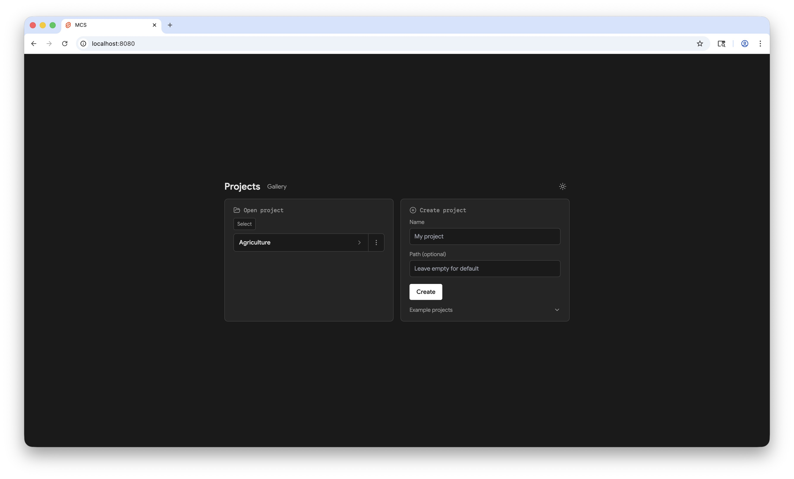

# Mission Control System

MCS is a local telemetry workspace built with SvelteKit and SQLite. It accepts normalized timestamped samples, stores them in portable project folders, and displays them with plots, gauges, tables, notes, video, and reusable layouts.



## Create a project

The public package flow is designed to work like a Svelte project:

```bash
npm create mcs@latest my-project
cd my-project
npm run dev -- --open
```

The `create-mcs` and `mcs-platform` packages are prepared in this repository but are not published yet. Until the first release is published, use the source workflow below.

Each generated project is a normal directory with its own package lock, `project.json`, `mcs.db`, and `.mcs/meta.json`. Run `mcs open` through the generated scripts to enter that project directly. Use `npm run doctor` to validate it. Runtime updates and project-data migrations are separate: `npm update mcs-platform` changes the installed package, then `mcs upgrade .` applies explicit, backed-up project migrations. `npm run update` is the compatible wrapper for both steps.

## Develop the repository

Node.js 22 or newer is required.

```bash
git clone https://github.com/larspatkowa/MCS.git
cd MCS
npm ci
npm run dev
```

Open [http://127.0.0.1:8080](http://127.0.0.1:8080). Use [the project manager](http://127.0.0.1:8080/projects) to create or open a project.

## Test the packaged flow locally

```bash
npm run test:package
```

This packs both release artifacts into a temporary directory, installs them as a user would, creates a blank project, starts the packaged production server, writes and reads a telemetry sample, stops cleanly, and verifies SQLite integrity. The temporary directory is removed afterward.

## Send telemetry

Copy the project ID from the project screen and post a reading:

```bash
curl -X POST http://127.0.0.1:8080/api/ingest \
  -H "Content-Type: application/json" \
  -d '{
    "projectId": "YOUR_PROJECT_ID",
    "streamId": "my-sensor:temperature",
    "values": { "value": 22.5 }
  }'
```

Hardware suppliers own capture and calibration. MCS accepts their normalized samples or an imported run package through the narrow adapter boundary.

For versioned, time-aware ingestion, use `/api/ingest/v2`. Source timestamps,
clock quality, sequence numbers, and idempotency keys are retained with
normalized event time. MCS provides continuous SQLite history with configurable
retention alongside saved runs. See [`mcs/README.md`](mcs/README.md) for the
provider query API, clock conventions, bridge tokens, and backup/restore.

## Logs and replay

The project screen can export and import versioned run packages. Packages include stream definitions, raw timestamped samples, capture metadata, optional media tracks, and integrity information. Replay and export use one canonical clock.

## Verification

```bash
npm run verify:release
```

This runs static checks, formatting and lint checks, unit tests, production builds, application browser tests, documentation browser tests, and the installed package flow. See the [release checklist](docs/release-checklist.md) for the evidence required before publishing.

MCS binds to loopback by default. A non-loopback bind requires
`--allow-remote`, `MCS_AUTH_REQUIRED=1`, and a bootstrap secret, and the service
must sit behind HTTPS. Use `/api/health/ready` for database, source-freshness,
and authentication readiness. See [Security](SECURITY.md) before deployment.

## Fonts and license

MCS is MIT licensed. Instrument Sans is bundled under the SIL Open Font License; its license is stored beside the font files in both applications. Earlier Google Fonts files were also distributed under the SIL Open Font License, so the original Git commit does not need to be erased. A normal commit that removes those files and keeps the required font licenses is sufficient.
